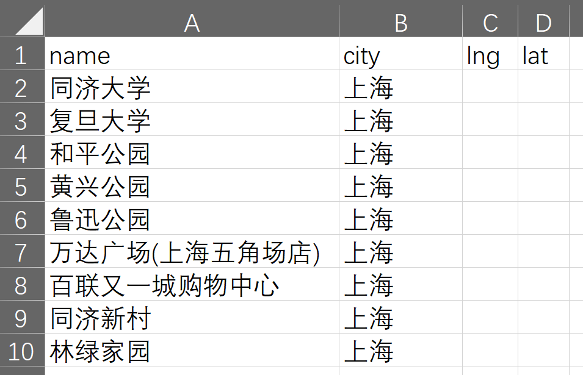
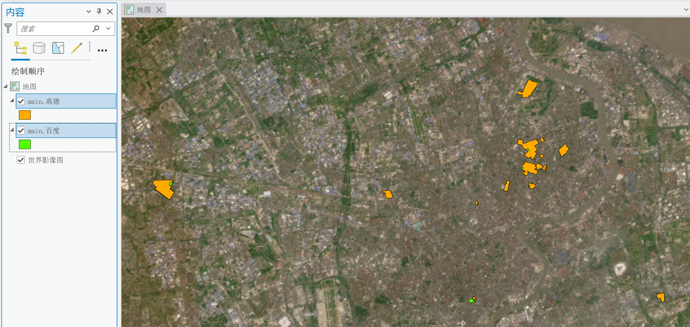

# get-aoi —— 名称 → AOI 兴趣面获取工具

给一份**地名清单**，自动完成「名称 → 检索 → 候选过滤 → 综合排序 → 抠边界 → 坐标转换」，输出每个地名对应的 **AOI 边界面**（GeoJSON / GeoPackage / Shapefile，统一 WGS-84）。

支持**高德、百度**两个数据源，均采用「名称 → uid → 边界」完整路径，通过统一的 Provider 抽象层抹平差异。





> ⚠️ **免责声明**：本工具 AOI 边界来自高德/百度**网页隐藏接口**（非官方公开 API），仅供**学习使用**，请控制请求频率，**勿大规模爬取**。商用请走官方开放平台高阶服务。使用本工具产生的一切后果由使用者自行承担。

---

## 特性

- **完整路径，端到端**：输入是"名称"（而非 poi_id），工具自己完成检索、过滤、匹配、抠边界全流程。
- **多源统一**：高德 + 百度两个 Provider，实现同一套「名称 → 候选 → 边界」语义，上层无感知切换。
- **候选相关性控制**：分类/子面过滤 → 名称相关筛选 → 多结果取舍 → 需要时综合排序，避免把其他相似检索结果混入成果。
- **坐标自动对齐**：内置 GCJ-02 / BD09 / bd09mc ↔ WGS-84 转换。
- **三种输出**：GeoJSON（零依赖）/ GeoPackage / Shapefile（后两者需 geopandas）。
- **结果报告**：额外导出 `summary.csv`（逐地名成败汇总）与 `aoi_attributes.csv`（扁平属性表），无需加载到 GIS 也能核对。
- **边界缓存**：按 poi_id 持久化已抠边界，跨次运行复用，既提速又降低反爬风险。
- **断点续跑**：按名称记已完成清单，中断后 `--resume` 接着跑，不重复请求。
- **成果独立归档**：每次运行写入 `runs/时间_CSV文件名_引擎/` 新目录，含配置快照、状态与日志；多结果默认全部保留。
- **密钥安全**：YAML 配置 / `key_file` / 环境变量三级来源，密钥不进命令行、不提交 Git。
- **轻量**：核心仅需 `requests` + `pyyaml`；GeoJSON 导出零额外依赖，gpkg/shp 导出才需 geopandas。

## 安装

```bash
git clone https://github.com/Urbankernel/get_aoi get-aoi
cd get-aoi
pip install -r requirements.txt 
```

要求 Python ≥ 3.9。需要导出 gpkg/shp 时再装可选依赖：

```bash
pip install geopandas     # 推荐使用 conda 安装
```

## 运行方式

本工具是命令行工具，入口（主函数）在 `src/get_aoi/cli.py` 的 `main()`，通过 `pyproject.toml` 注册为 `get-aoi` 命令。有两种运行方式：

**方式一：安装后使用 `get-aoi` 命令（推荐）**

```bash
pip install .      # 安装时自动生成 get-aoi 命令
get-aoi run -c configs/example.yaml
```

**方式二：不安装，用 `python -m` 模块方式**

```bash
# Linux / macOS
PYTHONPATH=src python -m get_aoi.cli run -c configs/example.yaml

# Windows PowerShell
$env:PYTHONPATH="src"; python -m get_aoi.cli run -c configs/example.yaml
```

> 注意：不能直接 `python src/get_aoi/cli.py` 运行，因为 `cli.py` 内部使用相对导入（`from .config import ...`），当普通脚本跑会报 `ImportError`。

以下命令示例以 `get-aoi` 为例，使用方式二时把 `get-aoi` 换成 `python -m get_aoi.cli` 即可：

```bash
# 干跑估算：只读清单、估算请求数（不发 POI 请求）
get-aoi estimate -c configs/example.yaml

# 执行抓取
get-aoi run -c configs/example.yaml

# 断点续跑（中断/失败后）
get-aoi run -c configs/example.yaml --resume runs/20261025_180121_names_amap

# CLI 覆盖配置（小样验证常用）
get-aoi run -c configs/example.yaml --provider baidu --want main --city 上海
```

> ⚠️ **断点续跑的前提：`cache.enabled` 必须为 `true`（默认即是）。**
> 断点文件 `state.json` 只记录每个面「存在过」的摘要（poi_id 等），**不保存几何坐标**；续跑时靠 poi_id 从边界缓存（`~/.cache/get_aoi`）回填完整几何，再把「上次已完成 + 本次新抓」合并导出，避免覆盖历史成果。若关闭了缓存（`cache.enabled: false`）或清空了缓存目录，已完成的项无法回填，工具会**自动清除这些项的完成标记并重新抓取**。因此：**续跑前请保持 `cache.enabled: true`，且不要删除 `cache.dir` 指向的缓存目录**。

## 准备工作

1. **数据源密钥**：高德到 [高德开放平台](https://lbs.amap.com) 申请「Web 服务」类型 Key；百度到 [百度地图开放平台](https://lbsyun.baidu.com) 申请「服务端」AK。
2. **地名清单** `data/names.csv`：

   ```csv
   name,city,lng,lat
   同济大学,上海,,
   故宫博物院,北京,,
   广州塔,广州,,
   ```

   `name` 必填；`city` 建议填写，可缩小检索范围；`lng,lat` 可选（参考坐标，用于距离打分与 `user_loc` 请求参数）。

## 配置

复制 `configs/example.yaml` 改成自己的配置。关键字段：

| 字段 | 说明 | 默认 |
|------|------|------|
| `keys` / `key_file` / 环境变量 | 高德/百度密钥（三选一，优先级从高到低） | — |
| `provider` | 数据源 `amap` / `baidu` | amap |
| `input` | 地名清单 csv 路径 | 必填 |
| `city` | 全局城市（csv 无 city 列时生效） | "" |
| `want` | 多结果取舍：`all` 全部 / `main` 取最优 / `keyword` 指定 | all |
| `keyword` | `want=keyword` 时的分支关键词 | "" |
| `keep_types` | 分类白名单，逗号分隔，任一级命中即保留（可填一级或二级分类，取值参考 `docs/` 分类表） | "" |
| `min_area` / `max_area` | 面积过滤（km²） | 0 / 1e9 |
| `max_candidates` | 每地名最大候选数 | 10 |
| `request.min_interval` / `.max_interval` | 请求间隔秒（随机抖动） | 3.0 / 10.0 |
| `request.retries` | 失败重试次数 | 3 |
| `request.timeout` | 单次请求超时（秒） | 15.0 |
| `request.proxy` | 代理，如 `http://127.0.0.1:7890` | "" |
| `request.concurrency` | 并发 worker 数（1=串行；>1 共享限流器） | 1 |
| `outputs.dir` | run 目录根 | runs |
| `outputs.format` | 输出格式 `geojson` / `gpkg` / `shp` | geojson |
| `outputs.report` | 额外导出 `summary.csv` / `aoi_attributes.csv` | true |
| `cache.enabled` | 是否启用按 poi_id 的边界缓存 | true |
| `cache.dir` | 缓存目录（留空则 `~/.cache/get_aoi`） | "" |

**`keep_types` 分类取值**：高德、百度各自维护独立的 POI 分类体系，`keep_types` 可填任意一级或二级分类名称，任一级命中即保留。分类取值参考 `docs/` 下的平台分类表：

- 百度：`docs/百度地图POI行业分类.xlsx`（35 个一级分类、281 个二级分类）
- 高德：`docs/高德POI分类与编码（中英文）_V1.06_20230208.xlsx`

**密钥三级来源**（优先级从高到低）：

1. **配置文件 `keys` 字段**：`keys: { amap: "xxx", baidu: "yyy" }`
2. **`key_file` 文件**：每行 `字段=值`（`amap=xxx` / `baidu=yyy`；`#` 开头为注释）。复制 `configs/keys.txt.example` 为 `configs/keys.txt` 后填写。
3. **环境变量**：`AMAP_KEY` / `BAIDU_AK`

如果网页隐藏接口触发人机验证，还可在配置中提供浏览器会话：

```yaml
headers:
  amap_cookie: "从浏览器成功GET请求复制的完整Cookie"
  amap_user_agent: "同一请求的User-Agent"
  # 仅 Cookie + UA 仍失败时，再复制同一 GET 请求中的动态头：
  amap_bx_ua: ""
  amap_bx_umidtoken: ""
  amap_bx_et: ""
  amap_x_csrf_token: ""
  amap_x_adiu: ""
  amap_referer: ""
  baidu_cookie: ""
  baidu_user_agent: ""
```

获取方式：浏览器正常打开目标地点并完成验证 → `F12` → `Network` → 选择 **Request Method 为 GET** 且成功的 `getPoiInfo?id=...` → `Headers` → `Request Headers`。先复制 `Cookie` 和 `User-Agent`；仍触发风控时再整组复制动态头。

动态头只附加到边界请求，不会用于官方 `place/text` 检索。它们可能随会话过期，更新时应从同一次成功 GET 整组重新复制。

## 输出

每次运行生成独立 run 目录：

```
runs/20261025_180121_names_amap/
├── config.snapshot.yaml    # 配置快照（key 脱敏，续跑校验用）
├── state.json              # 断点续跑状态（按名称记已完成清单）
├── run.log                 # 完整日志
└── outputs/
    ├── aoi.geojson         # 成果（WGS-84，format 为 gpkg/shp 时对应 aoi.gpkg / aoi.shp）
    ├── summary.csv         # 逐地名成败汇总（name / status / matched_count）
    └── aoi_attributes.csv  # 每个 AOI 面的扁平属性表
```

`summary.csv` 每行一个输入地名，记录 `Matched` / `No Candidate` / `No Geometry` 及匹配面数，快速核对哪些成功、哪些失败；`aoi_attributes.csv` 每行一个 AOI 面，含 poi_id、名称、分类、地址、面积、中心点及高德扩展属性，数组字段转成 JSON 字符串（可用 `json.loads()` 还原）。两者由 `outputs.report` 控制，默认开启。

没有匹配到 AOI 时不生成输出文件。

### 高德扩展属性

高德边界响应 `data.base` 中的 `typecode`、`type`、`newtype`、`adcode`、`citycode`、`cityname`、`districtname`、`tel` 会随 AOI 一并写入属性表。同时 `data.tags` 的以下字段也会写入：

| 字段 | 内容 |
|---|---|
| `tag_show_info` | 展示标签列表，如双一流、985高校、近地铁等 |
| `t_tag_list` | 标签分类列表，如985大学、大学、高等教育 |
| `t_tag` | 主标签 |
| `tag_display` | 界面显示标签 |

GeoJSON 中前两个数组字段保留为 JSON 数组。GeoPackage 中使用完整字段名，数组保存为可用 `json.loads()` 还原的 JSON 字符串。Shapefile 受 DBF 字段名最多 10 字符限制：`tag_show_info → tag_show`、`tag_display → tag_disp`、`districtname → district`；需要完整保留长标签时优先使用 **GeoPackage 或 GeoJSON**。

## 命令详解

### `get-aoi run` —— 名称清单 → AOI 面

| 参数 | 说明 |
|---|---|
| `-c, --config` | YAML 配置文件（必填） |
| `--provider` | 数据源 `amap` / `baidu`（覆盖配置） |
| `-i, --input` | 地名清单 csv（覆盖配置） |
| `--city` | 全局城市（覆盖配置） |
| `--want` | 多结果取舍 `all` / `main` / `keyword`（覆盖配置） |
| `--keyword` | `want=keyword` 时的分支关键词 |
| `--keep-types` | 分类白名单，逗号分隔，任一级命中即保留（取值参考 `docs/` 分类表） |
| `--min-area` / `--max-area` | 面积过滤（km²） |
| `--max-candidates` | 每地名最大候选数 |
| `--output-dir` | run 目录根（覆盖 `outputs.dir`） |
| `--format` | 输出格式 `geojson` / `gpkg` / `shp` |
| `--resume` | 从既有 run 目录断点续跑（须保持 `cache.enabled: true` 且缓存目录未被清空，见上文） |

例如，通过 `wand` 参数进行**多校区取舍**（"同济大学"有 5 个平级校区时）：

```bash
get-aoi run -c config.yaml --want main                  # 只要四平路主校区（综合排序取最优）
get-aoi run -c config.yaml --want all                   # 全部校区都要（默认）
get-aoi run -c config.yaml --want keyword --keyword 嘉定  # 只要嘉定校区
```

### `get-aoi estimate` —— 干跑估算（不联网）

```bash
get-aoi estimate -c config.yaml
```

只解析配置、读取清单、估算请求数，不发 POI 请求。用于上线前看规模、估配额。

### `get-aoi convert` —— 仅坐标转换（不联网）

```bash
get-aoi convert -i in.csv --crs gcj02              # gcj02 → wgs84（默认）
get-aoi convert -i in.csv --crs bd09mc --to wgs84  # 百度墨卡托 → wgs84
get-aoi convert -i in.csv --crs wgs84 --to bd09mc  # wgs84 → 百度墨卡托（逆变换）
```

输入 csv 需含 `lng,lat` 列（bd09mc 时填米制 x,y），输出追加 `<目标>_lng,<目标>_lat` 列。四个坐标系 `wgs84` / `gcj02` / `bd09` / `bd09mc` 已支持**两两互转**。

## 候选处理逻辑（核心）

过滤规则不绑定任何具体地名，统一适用于学校、医院、博物馆、住宅区、园区等 POI。处理顺序如下：

| 阶段 | 通用规则 | 被排除的典型情况 |
|---|---|---|
| ① 有效性与分类 | id 必填；百度 `detail != 1` 排除；执行分类白名单及交通设施/出入口黑名单 | 同名地铁站、公交站、停车场、出入口 |
| ② 父子关系 | 精确同名目标即使 `parent` 非空也保留；非精确同名的子 POI 排除 | 内部楼栋、附属小面 |
| ③ 名称标准化 | NFKC 统一全半角，忽略大小写、空白和常见括号/标点 | 仅格式不同不会误判为不同名称 |
| ④ 名称相关性 | 保留精确同名；保留以完整输入名开头的括号分支和通用分支/片区后缀 | 其他相似小区、周边设施、仅部分相似名称 |
| ⑤ 去重 | 单次 Provider 检索按 `poi_id` 去重，保留排名最前者 | 同一 POI 重复返回 |
| ⑥ 边界与面积 | 必须取得有效 Polygon/MultiPolygon，再按 `--min-area/--max-area` 过滤 | 点 POI、空边界、异常面积 |
| ⑦ 结果取舍 | `all` 全部相关结果；`main` 综合排序取最优；`keyword` 指定分支 | 与本次输出需求无关的结果 |

**通用分支/片区变体**包括：括号限定（如"名称(人民广场馆)"）、校区、院区、园区、馆区、厂区、分校、分院、分馆、分店、分部、本部、总院、总馆、新/老馆、新/旧址，以及带明确机构语义的方位院/园/馆和多期项目。单独的"东区/南区"不因方位词直接纳入。非精确变体中含"附属、内部、附近、周边、对面、旁边"等关系词时排除；但如果用户输入的完整名称本身就是精确匹配，仍可正常保留。

名称匹配采用**精确与明确变体优先、拒绝低置信模糊匹配**的策略。`parent` 只用于辅助判断父子关系，不再被简单等同为"无边界子面"。

**综合排序四维打分**（权重 0.4 / 0.3 / 0.2 / 0.1）：

| 维度 | 含义 |
|---|---|
| search_rank | 检索返回索引（官方相关性，第 0 条最相关） |
| similarity | 输入名称 vs 候选名称的文本相似度（先经 NFKC 标准化，全半角/括号/空白等价） |
| distance | 参考坐标 ↔ 面中心距离（越近越可能对） |
| area | 面积与候选集典型面积（中位数）的对数偏离度，越接近典型值得分越高，用于压低异常大/异常小面 |

## 性能调优

- **并发**：设 `request.concurrency` 为 2~4 可成倍提速（也可 CLI `--concurrency 4`）。并发下所有 worker 共享一个限流器，总 QPS 仍受 `min_interval`/`max_interval` 控制。官方检索相对安全，网页隐藏边界接口较敏感，并发不宜过高。
- **缓存**：默认开启，按 poi_id 复用已抠边界。重复跑同一清单（如改 `want`/过滤参数后重跑）时边界请求直接命中缓存，既快又降低反爬风险。缓存位于 `~/.cache/get_aoi`（可经 `cache.dir` 改）。⚠️ **该缓存同时是断点续跑回填几何的唯一来源**，清空缓存会让后续续跑丢失历史成果（自动转为重抓），仅在确认不再需要续跑时再删除。
- **翻页**：检索会自动翻页取满 `max_candidates` 个候选（高德每页 25、百度每页 20），重名场景不漏候选；`max_candidates` 增大时检索请求数也相应增加，注意配额。

## 坐标系说明

| 数据源 | 边界原生坐标 | 转换链 | 输出 |
|---|---|---|---|
| 高德 | GCJ-02（火星坐标） | gcj02 → wgs84 | WGS-84 |
| 百度 | bd09mc（百度墨卡托） | bd09mc → bd09 → gcj02 → wgs84 | WGS-84 |

两个数据源输出统一为 **WGS-84（EPSG:4326）**，可直接并入同一份 GIS 成果库。

## 常见问题

### `getPoiInfo` 返回风控或一直重试

新版会识别高德 `FAIL_SYS_USER_VALIDATE`、`RGV587_ERROR`、验证 HTML，并立即停止无效重试。按以下顺序处理：

1. 在浏览器正常打开高德网页版目标地点，必要时完成滑块验证，确认能看到 AOI 边界。
2. 确认选中的是 **GET `getPoiInfo?id=...`**，不是 OPTIONS 预检。先复制 `Cookie` 与 `User-Agent` 到配置 `headers`。
3. 若仍触发风控，再从同一个成功 GET 整组复制 `Bx-Ua`、`Bx-Umidtoken`、`Bx_et`、`X-Csrf-Token`、`X-Adiu`，分别写入 `amap_bx_ua` 等配置；这些动态值可能过期，失效后整组更新。
4. 增大 `request.min_interval` / `request.max_interval`，减少批量请求。
5. 若仍触发风控，说明当前 IP/会话不被接口接受，应稍后重试或更换合规网络；正式批量项目请申请官方 AOI 高阶服务，工具无法绕过平台风控。

> 触发风控中断时，已完成的部分成果会先落盘到 run 目录，可用 `--resume` 续跑，不丢数据。

### 百度与高德数据有出入（平台数据差异，非工具问题）

百度、高德各自维护独立的 POI 库，同一地点在两家平台可能「有面/无面」「命名不同」「收录范围不同」。这是平台数据差异造成的，不是抓取错误。两类典型情况：

1. **某平台未收录或无边界**：百度检索「同济新村」时，`qt=ext` 返回的 `content` 里只有 `uid`、没有 `geo` 字段（该 POI 无边界数据），因此拿不到 AOI 面；同一地点换高德可能就有数据，反之亦然。
2. **命名/收录口径不同**：高德检索「复旦大学」只能命中「复旦大学(枫林校区)-东区」，相邻的「复旦大学上海医学院」是另一个独立 POI，名称对不上就取不到，需用其准确名称「复旦大学上海医学院」单独检索。

应对建议：

- 拿不到面时换数据源交叉验证：改 `provider: amap` ↔ `provider: baidu`。
- 检索不到时改用 POI 的官方/完整名称，或补充校区、院区、分院等关键词。

## 目录结构

```
get-aoi/
├── pyproject.toml           # 打包与命令注册（get-aoi）
├── requirements.txt
├── configs/
│   ├── example.yaml         # 配置示例
│   └── keys.txt.example     # 密钥模板（复制为 keys.txt 后填写，Git 忽略）
├── src/get_aoi/
│   ├── cli.py               # 命令行入口（run / estimate / convert）
│   ├── config.py            # YAML 加载 + CLI 覆盖 + 校验 + 密钥三级来源
│   ├── store.py             # runs/ 目录管理（快照 / 状态 / 日志）
│   ├── models.py            # POIInput / Candidate / AOIRecord / Status
│   ├── providers/           # base / amap / baidu（search + fetch_boundary）
│   ├── core/                # retriever / filter / matcher / fetcher / geometry / state / cache / text
│   ├── utils/               # coords / http / ratelimit / logger
│   └── exporters/           # geojson / shapefile / geopackage / csv
├── data/names.csv           # 示例地名清单
├── runs/                    # 每次运行的独立成果目录（Git 忽略）
├── docs/                    # providers.md（接口/权限/配额/反爬）+ 高德/百度 POI 分类表（keep_types 取值参考）
└── tests/                   # 离线测试（坐标 / 配置 / 过滤 / 排序 / 目录 / 风控 / 端到端）
```


License: MIT
